# 1. Giới thiệu

## 1.1. Nội dung bài tập

Đề bài là chương 4 "Knowledge Graph và RAG" với sáu mục: mở đầu về lịch sử và vai trò
của KG và RAG, Knowledge Graph và Knowledge Base, RAG, rồi áp dụng KB và RAG cho ba bài
toán (bệnh tiểu đường, chứng khoán, vàng) và triển khai (deploy). Toàn bộ phần code nằm
trong một notebook chạy được trên Kaggle; mỗi mục của đề ứng với một chương của báo cáo:

| Mục trên đề | Nội dung | Chương |
|---|---|---|
| 4.1 | Mở đầu: KG và RAG, lịch sử; vai trò, ý nghĩa với AI | 2 |
| 4.2 | Knowledge Graph và Knowledge Base | 3 |
| 4.3 | RAG (và GraphRAG) | 4 |
| 4.4 | KB và RAG cho bệnh tiểu đường | 5 |
| 4.5 | KB và RAG cho chứng khoán, vàng | 6, 7 |
| 4.6 | Deploy | 8 |
|  | So sánh, đánh giá ba bài | 9 |

## 1.2. Ba bộ dữ liệu

|  | Tiểu đường | Chứng khoán | Vàng |
|---|---|---|---|
| Nguồn | PubMed (NCBI E-utilities) | yfinance, Google News RSS | yfinance, Google News RSS |
| Văn bản (text) | 298 abstract bài báo y khoa | 579 tiêu đề tin + mô tả 5 công ty | 632 tiêu đề tin về vàng |
| Bảng (table) | nhãn MeSH của từng bài | giá đóng cửa VNM, FPT, VCB, HPG, VIC; ngành, lĩnh vực | giá vàng và 7 yếu tố: USD, lợi suất TP Mỹ 10 năm, bạc, dầu, S&P 500, VIX, Bitcoin |
| Giai đoạn | kết quả liên quan nhất của truy vấn | 2020-01-01 đến 2026-10-15 (1.771 phiên) | cùng giai đoạn (2.480 dòng) |
| Câu hỏi đánh giá | 12 | 10 | 10 |

Ba bộ dữ liệu được chọn để có đủ hai dạng dữ liệu mà một hệ hỏi đáp thực tế gặp phải.
Bộ tiểu đường gần như thuần văn bản: tri thức nằm trong các câu của bài báo, và phải trích
thực thể (thuốc, biến chứng, bệnh) ra mới dựng được đồ thị. Hai bộ tài chính ngược lại:
phần lớn tri thức nằm trong **bảng số** (giá theo ngày), thứ mà RAG không đọc trực tiếp
được, cộng với tin tức dạng văn bản ngắn. Bộ chứng khoán dùng năm mã lớn của sàn HOSE ở
năm ngành khác nhau; bộ vàng đặt giá vàng cạnh các yếu tố vĩ mô thường được nhắc tới khi
giải thích giá vàng. Dữ liệu được tải lại mỗi lần chạy notebook; thư mục `data/` giữ bản
chụp ngày 15/10/2026 mà báo cáo này dùng.

## 1.3. Môi trường và cấu trúc thư mục

Notebook được viết để chạy trên Kaggle (bật Internet, CPU là đủ) và cũng chạy được trên
máy cá nhân: các số liệu trong báo cáo lấy từ lần chạy trên máy cá nhân với Python 3.14,
CPU. Mô hình embedding là `all-MiniLM-L6-v2` của sentence-transformers (khoảng 90 MB, tải
lần đầu từ Hugging Face); đồ thị dùng NetworkX; truy xuất từ khóa dùng TF-IDF của
scikit-learn; giao diện dùng Gradio. Không có thành phần nào cần GPU hay API key trả phí.

```
KG_RAG/
  RAG_KG_Kaggle.ipynb        notebook chính, mục 4.1-4.6, tự tải dữ liệu nếu thiếu
  data/                      bản chụp dữ liệu: PubMed, giá, tin tức (15/10/2026)
  results/summary.json       số liệu chính do notebook ghi ra
  figs/                      hình do notebook vẽ
  deploy/
    ragkg_core.py            phần lõi: chunking, NER từ điển, dựng KG, retriever, GraphRAG
    app.py                   giao diện Gradio cho cả 3 bài
    diabetes.json, stocks.json, gold.json    KB + KG + từ điển đã đóng gói
  docs/demo/                 ảnh chụp giao diện
  tools/build_report.py      sinh báo cáo này (.md -> .docx -> .pdf)
  A05_07_quanlh.676.docx / .pdf   báo cáo này
  README.md
```

File `ragkg_core.py` được chính notebook ghi ra (lệnh `%%writefile`) rồi import lại, nên
notebook và bản deploy dùng chung đúng một bản code. Mọi đoạn code trong báo cáo được trích
tự động từ file này và từ notebook, không gõ lại bằng tay. Mã nguồn đầy đủ ở https://github.com/lyhaiquan/KG_RAG.

# 2. Mở đầu: KG và RAG (mục 4.1)

## 2.1. Lịch sử Knowledge Graph

Ý tưởng biểu diễn tri thức bằng nút và cạnh có từ thập niên 1960 với *semantic network*
của Quillian: mỗi khái niệm là một nút, quan hệ giữa các khái niệm là cạnh có nhãn. Năm
2001, Berners-Lee đề xuất *Semantic Web*, chuẩn hóa tri thức thành các bộ ba (chủ thể, quan
hệ, đối tượng) với RDF, OWL và ngôn ngữ truy vấn SPARQL. Giai đoạn 2007-2014 xuất hiện các
KG mở quy mô lớn như DBpedia, Freebase, Wikidata. Năm 2012 Google công bố Knowledge Graph
với khẩu hiệu "things, not strings": máy tìm kiếm trả lời về *thực thể* chứ không chỉ khớp
chuỗi ký tự. Từ đó KG thành hạ tầng cho tìm kiếm, hệ gợi ý, y sinh (UMLS, DrugBank,
Hetionet) và tài chính.

## 2.2. Lịch sử RAG

RAG (Retrieval-Augmented Generation) được Lewis và cộng sự (Facebook AI) đề xuất năm 2020:
trước khi sinh câu trả lời, mô hình truy xuất các đoạn văn liên quan từ một kho tài liệu
và sinh câu trả lời dựa trên các đoạn đó. Giai đoạn 2022-2023, khi các mô hình ngôn ngữ lớn
(LLM) phổ biến, RAG kết hợp với cơ sở dữ liệu vector (FAISS, Chroma...) thành mẫu thiết kế
tiêu chuẩn cho chatbot trên tài liệu riêng. Năm 2024, GraphRAG (Microsoft và cộng đồng)
đưa KG vào RAG: thay vì chỉ tìm đoạn văn giống câu hỏi, hệ thống đi theo quan hệ trong đồ
thị để gom thông tin nằm rải rác ở nhiều tài liệu.

## 2.3. Vai trò và ý nghĩa với AI

| Vấn đề của LLM thuần | KG / RAG giải quyết thế nào |
|---|---|
| Bịa thông tin (hallucination) | câu trả lời dựa trên tài liệu truy xuất được, có trích nguồn |
| Kiến thức cũ | chỉ cần cập nhật kho tài liệu, không phải huấn luyện lại |
| Khó giải thích | KG cho thấy đường suy luận: thực thể, quan hệ, thực thể |
| Câu hỏi nhiều bước | duyệt đồ thị để nối thông tin nằm ở nhiều tài liệu |
| Dữ liệu chuyên ngành, riêng tư | dùng kho tri thức nội bộ, không phụ thuộc dữ liệu huấn luyện |

Hai kỹ thuật bổ sung cho nhau. RAG mạnh ở chỗ tìm đúng đoạn văn có câu trả lời; KG
mạnh ở chỗ biết các thực thể liên quan với nhau thế nào, kể cả khi chúng không xuất hiện
trong cùng một đoạn văn. Bài này đo trực tiếp khi nào phần KG giúp ích, bằng cách chạy cùng
một bộ câu hỏi qua RAG thường và GraphRAG (chương 9).

# 3. Knowledge Graph và Knowledge Base (mục 4.2)

## 3.1. Khái niệm

**Knowledge Base (KB)** là kho tri thức có cấu trúc hoặc bán cấu trúc: các đoạn văn đã
làm sạch, bảng số liệu, ontology. **Knowledge Graph (KG)** là KB được biểu diễn dưới dạng
đồ thị, gồm các bộ ba (chủ thể, quan hệ, đối tượng), ví dụ
(SGLT2 inhibitor, drug_studied_for, Nephropathy). Trong bài, KB của mỗi bài toán là một
danh sách *tài liệu*, mỗi tài liệu có ba trường: nội dung văn bản, nguồn (PMID, mã tin, mã
bảng thống kê) và danh sách thực thể xuất hiện trong nó. KG được dựng từ KB đó.

## 3.2. Từ bảng và văn bản tới KB

Văn bản dài (abstract) được chia thành đoạn ngắn để truy xuất chính xác hơn; bảng được
chuyển thành câu văn vì RAG chỉ truy xuất được văn bản. Hai hàm dưới cắt văn bản thành câu
và gom 3 câu thành một đoạn, có gắn tiêu đề bài ở đầu để đoạn nào cũng giữ được ngữ cảnh:

```python
def split_sentences(t):
    return [s.strip() for s in re.split(r"(?<=[.!?])\s+", t) if s.strip()]


def chunk_text(title, text, n=3):
    sents = split_sentences(text)
    return [f"{title}. " + " ".join(sents[i : i + n]) for i in range(0, len(sents), n)]
```

Chuyển bảng thành câu văn là việc của chương 6 và 7 (hàm `stats_to_text`, `corr_text`).

## 3.3. Nhận diện thực thể

Thực thể được nhận diện bằng từ điển: mỗi thực thể có một loại và một biểu thức chính
quy gom các cách viết khác nhau về một tên chuẩn, ví dụ "empagliflozin", "dapagliflozin"
đều là `SGLT2 inhibitor`.

```python
def compile_lexicon(lex):
    return {k: re.compile(v[1], re.I) for k, v in lex.items()}


def extract_entities(text, rx):
    return sorted(k for k, r in rx.items() if r.search(text))
```

`compile_lexicon` biên dịch trước mọi regex với cờ `re.I` (không phân biệt hoa thường),
vì cùng một regex sẽ được dùng cho hàng nghìn đoạn văn. `extract_entities` giữ lại thực thể
nào có regex tìm thấy trong đoạn văn và sắp xếp kết quả để mỗi lần chạy ra cùng thứ tự.
So với dùng mô hình NER hay LLM, cách này chính xác, nhanh, không cần API và dễ kiểm tra
bằng mắt, đổi lại độ phủ thấp hơn (chỉ bắt được cách viết có trong từ điển).

## 3.4. Dựng Knowledge Graph

Quan hệ được lấy từ ba nguồn. Từ **văn bản**: hai thực thể cùng xuất hiện trong một
tài liệu thì nối một cạnh. Từ **bảng**: hệ số tương quan lợi suất thành cạnh
`CORRELATED_WITH`, ngành của công ty thành cạnh `BELONGS_TO_SECTOR` (chương 6, 7). Từ **tri
thức chuyên gia**: vài quan hệ nhân quả kinh tế đã biết (bài vàng). Phần dùng chung:

```python
def make_rel(table):
    def rel(t1, t2):
        return table.get((t1, t2)) or table.get((t2, t1)) or "related"

    return rel


def new_kg(lex):
    G = nx.Graph()
    for name, (t, _) in lex.items():
        G.add_node(name, kind="entity", etype=t)
    return G


def add_cooccurrence(G, docs, rel, skip_types=("Year",), doc_key=None, doc_kind="doc"):
    """Quan hệ từ văn bản: 2 thực thể cùng xuất hiện trong 1 tài liệu -> 1 cạnh.

    Trọng số cạnh = số tài liệu mà hai thực thể cùng xuất hiện."""
    for d in docs:
        ents = [e for e in d["entities"] if G.nodes[e]["etype"] not in skip_types]
        if doc_key:
            dn = d[doc_key]
            if dn not in G:
                G.add_node(dn, kind=doc_kind)
            for e in ents:
                G.add_edge(dn, e, rel="MENTIONS", weight=1)
        for a, b in itertools.combinations(ents, 2):
            if G.has_edge(a, b):
                G[a][b]["weight"] += 1
            else:
                G.add_edge(
                    a,
                    b,
                    rel=rel(G.nodes[a]["etype"], G.nodes[b]["etype"]),
                    weight=1,
                    source="text",
                )
    return G
```

`make_rel` nhận một bảng tra (cặp kiểu thực thể -> tên quan hệ) và trả về hàm đặt tên
quan hệ không phụ thuộc thứ tự hai đầu: (Drug, Complication) và (Complication, Drug) đều
cho `drug_studied_for`. `new_kg` tạo trước đủ các nút thực thể của từ điển, kể cả thực thể
chưa xuất hiện, để đồ thị của mọi lần chạy có cùng tập nút.

`add_cooccurrence` duyệt từng tài liệu. Thực thể loại `Year` bị bỏ vì năm xuất hiện cùng
mọi thứ và chỉ tạo cạnh nhiễu. Nếu có `doc_key` (bài tiểu đường dùng PMID), hàm thêm một nút
cho tài liệu và cạnh `MENTIONS` tới từng thực thể, nhờ đó từ một thực thể có thể lần ngược
ra các bài báo nhắc tới nó. `itertools.combinations(ents, 2)` sinh mọi cặp thực thể trong
tài liệu; cặp đã có cạnh thì tăng `weight` thêm 1, nên trọng số cuối cùng là số tài liệu mà
hai thực thể cùng xuất hiện. Thuộc tính `source="text"` ghi lại nguồn gốc của cạnh để phân
biệt với cạnh từ bảng (`table`) và từ tri thức chuyên gia (`domain`).

## 3.5. Lưu trữ đồ thị

```python
def graph_to_dict(G):
    return {
        "nodes": [[n, dict(a)] for n, a in G.nodes(data=True)],
        "edges": [[u, v, dict(a)] for u, v, a in G.edges(data=True)],
    }


def graph_from_dict(d):
    G = nx.Graph()
    G.add_nodes_from((n, a) for n, a in d["nodes"])
    G.add_edges_from((u, v, a) for u, v, a in d["edges"])
    return G
```

Đồ thị được lưu dưới dạng danh sách nút và cạnh kèm thuộc tính, ghi vào JSON cùng KB và
từ điển để bản deploy nạp lại mà không phải chạy lại notebook (chương 8). Notebook cũng xuất
GraphML (`nx.write_graphml`) để có thể nạp vào Neo4j khi cần truy vấn bằng Cypher.

# 4. RAG và GraphRAG (mục 4.3)

## 4.1. Kiến trúc

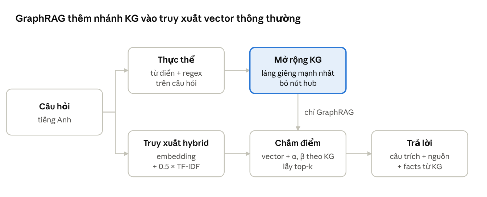{width=100%}

Cả ba bài dùng cùng một pipeline. Câu hỏi được chấm điểm với mọi tài liệu trong KB bằng
truy xuất vector; GraphRAG cộng thêm điểm dựa trên KG; k tài liệu điểm cao nhất được dùng để
dựng câu trả lời. Điểm của tài liệu $d$ với câu hỏi $q$:

$$\mathrm{score}(d) = \cos_{\mathrm{emb}}(q,d) + 0{,}5\,\cos_{\mathrm{tfidf}}(q,d) + \alpha\,|E(q)\cap E(d)| + \beta\,|N(q)\cap E(d)|$$

trong đó $E(q)$, $E(d)$ là tập thực thể của câu hỏi và của tài liệu, $N(q)$ là các
thực thể láng giềng của $E(q)$ trong KG, $\alpha = 0{,}10$ và $\beta = 0{,}04$. RAG thường
là trường hợp $\alpha = \beta = 0$.

## 4.2. Truy xuất hybrid

```python
class Retriever:
    """Hybrid: embedding (sentence-transformers) + TF-IDF.

    Không cài được sentence-transformers thì chỉ dùng TF-IDF."""

    def __init__(self, texts, use_embeddings=True, model_name="all-MiniLM-L6-v2"):
        self.texts, self.mode = texts, "tfidf"
        if use_embeddings:
            try:
                from sentence_transformers import SentenceTransformer

                try:
                    from transformers.utils import logging as hf_log

                    hf_log.disable_progress_bar()
                    hf_log.set_verbosity_error()
                except Exception:
                    pass
                self.model = SentenceTransformer(model_name)
                self.emb = self.model.encode(
                    texts,
                    normalize_embeddings=True,
                    batch_size=64,
                    show_progress_bar=False,
                )
                self.mode = "hybrid"
            except Exception as e:
                print(
                    "Không dùng được embedding, chuyển sang TF-IDF:", type(e).__name__
                )
        self.vec = TfidfVectorizer(
            stop_words="english", ngram_range=(1, 2), sublinear_tf=True
        )
        self.tfidf = self.vec.fit_transform(texts)

    def scores(self, q):
        lex = (self.tfidf @ self.vec.transform([q]).T).toarray().ravel()
        if self.mode == "hybrid":
            return (
                self.emb @ self.model.encode([q], normalize_embeddings=True)[0]
                + 0.5 * lex
            )
        return lex
```

TF-IDF luôn được dựng. `self.vec.transform([q])` biến câu hỏi thành vectơ TF-IDF; nhân
với ma trận TF-IDF của toàn bộ tài liệu cho ra cosine với từng tài liệu, vì scikit-learn đã
chuẩn hóa mỗi vectơ về độ dài 1. Nếu cài được sentence-transformers, câu hỏi và tài liệu
được mã hóa bằng mô hình embedding với `normalize_embeddings=True`, nên tích vô hướng cũng là
cosine. Điểm cuối = cosine embedding + 0,5 × cosine TF-IDF: phần ngữ nghĩa làm chính, phần
từ khóa bù cho những thứ embedding hay bỏ lỡ như mã cổ phiếu "HPG" hay năm "2021". Không có
sentence-transformers thì chỉ dùng TF-IDF, nên code vẫn chạy được; bản deploy chủ động dùng
cách này cho nhẹ.

## 4.3. GraphRAG: mở rộng qua KG và cộng điểm

```python
def neighbors(self, ents, topn=4):
    cand = collections.Counter()
    for e in ents:
        if e not in self.G:
            continue
        for nb, d in self._ent_neighbors(e):
            if nb not in ents and nb not in self.hubs:
                cand[nb] += d.get("weight", 1)
    return [n for n, _ in cand.most_common(topn)]


def retrieve(self, q, k=4, mode="graph", alpha=0.10, beta=0.04):
    s = np.array(self.ret.scores(q), dtype=float)
    qe = self.entities(q)
    nb = self.neighbors(qe) if mode == "graph" else []
    if mode == "graph":
        for i, d in enumerate(self.docs):
            de = set(d["entities"])
            s[i] += alpha * len(de & set(qe)) + beta * len(de & set(nb))
    idx = np.argsort(-s)[:k]
    return (
        [
            {
                "i": int(i),
                "score": float(s[i]),
                "entities": self.docs[i]["entities"],
            }
            for i in idx
        ],
        qe,
        nb,
    )
```

`neighbors` duyệt các nút thực thể kề với mỗi thực thể trong câu hỏi, bỏ những láng giềng
đã có trong câu hỏi và các nút *hub*: thực thể có mặt trong hơn 30% tài liệu (ví dụ GOLD
trong bài vàng). Hub nối với gần như mọi thứ nên không giúp phân biệt tài liệu. Trọng số cạnh
được cộng dồn vào `Counter`, nên một láng giềng nối với nhiều thực thể của câu hỏi được xếp
cao hơn; hàm trả về tối đa 4 láng giềng, chính là $N(q)$.

`retrieve` tính điểm vector cho mọi tài liệu, nhận diện $E(q)$ bằng cùng từ điển đã dùng
cho tài liệu, rồi ở chế độ `graph` cộng $\alpha$ cho mỗi thực thể trùng với câu hỏi và
$\beta$ cho mỗi thực thể trùng với láng giềng. `np.argsort(-s)[:k]` lấy k tài liệu điểm
cao nhất. Hàm trả kèm $E(q)$ và $N(q)$ để giao diện hiển thị phần mở rộng KG.

## 4.4. Sinh câu trả lời

```python
def facts(self, ents, per_entity=4):
    out = []
    for e in ents:
        if e not in self.G:
            continue
        for nb, d in sorted(
            self._ent_neighbors(e), key=lambda x: -x[1].get("weight", 1)
        )[:per_entity]:
            extra = f", corr={d['corr']:+.2f}" if "corr" in d else ""
            rel, w = d.get("rel", "related"), d.get("weight", 1)
            out.append(f"({e}) -[{rel}, w={w:.1f}{extra}]-> ({nb})")
    return out


def answer(self, q, k=4, mode="graph", n_sent=3):
    hits, qe, nb = self.retrieve(q, k, mode)
    qw = set(re.findall(r"[a-z0-9\-]{3,}", q.lower())) - STOP
    cands, seen = [], set()
    for h in hits:
        for sent in split_sentences(self.docs[h["i"]]["text"]):
            if sent in seen:
                continue
            seen.add(sent)
            ov = len(qw & set(re.findall(r"[a-z0-9\-]{3,}", sent.lower())))
            cands.append(
                (ov, h["score"], sent, self.docs[h["i"]].get("source", ""))
            )
    cands.sort(key=lambda x: (-x[0], -x[1]))
    top = cands[:n_sent]
    return {
        "answer": " ".join(c[2] for c in top),
        "sources": sorted({c[3] for c in top if c[3]}),
        "query_entities": qe,
        "graph_expansion": nb,
        "kg_facts": self.facts(qe) if mode == "graph" else [],
        "hits": hits,
    }
```

Câu trả lời mặc định là *trích xuất*: tách top-k tài liệu thành câu, chấm mỗi câu theo
số từ trùng với câu hỏi (đã bỏ stopword), lấy 3 câu cao nhất, kèm nguồn. Ở chế độ GraphRAG,
`facts` đọc các cạnh mạnh nhất quanh thực thể của câu hỏi và in thành bộ ba có trọng số,
ví dụ `(HPG) -[CORRELATED_WITH, w=5.3, corr=+0.43]-> (VCB)`. Cách trích xuất không cần API
key và không thể bịa thông tin; notebook có thêm một ô tùy chọn dùng LLM flan-t5-large để
viết lại câu trả lời từ cùng ngữ cảnh và facts.

## 4.5. Cách đánh giá

```python
def context_recall(rag, questions, k=4, mode="graph"):
    """Tỉ lệ câu hỏi mà top-k ngữ cảnh chứa đủ mọi từ khóa vàng (regex)."""
    ok = []
    for q, gold in questions:
        hits, _, _ = rag.retrieve(q, k, mode)
        ctx = " ".join(rag.docs[h["i"]]["text"] for h in hits).lower()
        ok.append(all(re.search(g, ctx) for g in gold))
    return float(np.mean(ok)), ok
```

Mỗi câu hỏi có một danh sách từ khóa vàng dạng regex. Câu hỏi được tính đúng khi top-k
tài liệu truy xuất được chứa **đủ** mọi từ khóa. Ví dụ câu "How do SGLT2 inhibitors affect
kidney disease in diabetes?" có hai regex `sglt|gliflozin` và `kidney|nephro`. Đây là độ đo
cho bước truy xuất (context recall@k), không đo chất lượng câu văn trả lời; nó trả lời câu
hỏi chính của bài: phần KG có giúp tìm đủ ngữ cảnh hơn không. Mỗi bài có 10-12 câu hỏi, đánh
giá ở k = 2, 4, 6.

# 5. Bài 1: KB và RAG cho bệnh tiểu đường (mục 4.4)

## 5.1. Dữ liệu

Dữ liệu là 298 abstract PubMed lấy qua NCBI E-utilities, truy vấn theo MeSH "diabetes
mellitus" kèm treatment, complications hoặc diagnosis, sắp theo mức liên quan:

```python
def fetch_pubmed(path, n=300):
    from Bio import Entrez

    Entrez.email = "student@example.com"
    q = (
        "(diabetes mellitus[MeSH Terms]) AND (treatment OR complications OR diagnosis) "
        "AND hasabstract AND English[lang]"
    )
    ids = Entrez.read(Entrez.esearch(db="pubmed", term=q, retmax=n, sort="relevance"))[
        "IdList"
    ]
    recs = []
    for i in range(0, len(ids), 100):
        xml = Entrez.read(
            Entrez.efetch(db="pubmed", id=",".join(ids[i : i + 100]), retmode="xml")
        )
        for art in xml["PubmedArticle"]:
            c = art["MedlineCitation"]
            a = c["Article"]
            ab = " ".join(str(t) for t in a.get("Abstract", {}).get("AbstractText", []))
            mesh = [str(m["DescriptorName"]) for m in c.get("MeshHeadingList", [])]
            recs.append(
                {
                    "pmid": str(c["PMID"]),
                    "title": str(a["ArticleTitle"]),
                    "abstract": ab,
                    "mesh": mesh,
                }
            )
    with open(path, "w", encoding="utf-8") as f:
        for r in recs:
            f.write(json.dumps(r, ensure_ascii=False) + "\n")
```

`esearch` trả về danh sách PMID, `efetch` lấy chi tiết theo lô 100 bài. Mỗi bài giữ lại
tiêu đề, abstract (ghép các phần Background, Methods...) và danh sách nhãn MeSH.

```
298 bài báo; ví dụ: Granuloma Annulare: An Updated Review of Epidemiology, Pathogenesis,
    and Treatme
MeSH phổ biến: [('Humans', 297), ('Female', 165), ('Male', 146), ('Treatment Outcome',
    137), ('Middle Aged', 117), ('Adult', 91)]
1108 chunk; trung bình 0.82 thực thể/chunk
```

## 5.2. Knowledge Base

```python
DIAB_LEX = {
    "Metformin": ["Drug", r"metformin"],
    "Insulin": ["Drug", r"\binsulin"],
    "Sulfonylurea": ["Drug", r"sulfonylurea|glibenclamide|glimepiride|gliclazide"],
    "GLP-1 RA": [
        "Drug",
        r"glp-1|glucagon-like peptide|semaglutide|liraglutide"
        r"|dulaglutide|exenatide|tirzepatide",
    ],
    "SGLT2 inhibitor": [
        "Drug",
        r"sglt-?2|empagliflozin|dapagliflozin|canagliflozin|gliflozin",
    ],
    "DPP-4 inhibitor": ["Drug", r"dpp-?4|sitagliptin|linagliptin|saxagliptin|gliptin"],
    "Pioglitazone": ["Drug", r"pioglitazone|thiazolidinedione"],
    "Statin": ["Drug", r"\bstatins?\b|atorvastatin|rosuvastatin|simvastatin"],
    "Retinopathy": ["Complication", r"retinopath|macular edema"],
    "Nephropathy": [
        "Complication",
        r"nephropath|diabetic kidney disease"
        r"|chronic kidney disease|\bckd\b|albuminuria",
    ],
    "Neuropathy": ["Complication", r"neuropath"],
    "Cardiovascular disease": [
        "Complication",
        r"cardiovascular|heart failure|myocardial|coronary|atheroscler",
    ],
    "Stroke": ["Complication", r"stroke"],
    "Foot ulcer": ["Complication", r"foot ulcer|diabetic foot|amputation"],
    "Hypoglycemia": ["Complication", r"hypoglyc"],
    "Ketoacidosis": ["Complication", r"ketoacidosis|\bdka\b"],
    "Type 1 diabetes": ["Disease", r"type 1 diabetes|\bt1d\b|type 1 dm"],
    "Type 2 diabetes": [
        "Disease",
        r"type 2 diabetes|\bt2d\b|\bt2dm\b|type 2 dm"
        r"|đái tháo đường type 2|tiểu đường type 2",
    ],
    "Gestational diabetes": [
        "Disease",
        r"gestational diabetes|\bgdm\b|tiểu đường thai kỳ",
    ],
    "Obesity": ["Disease", r"obesity|overweight|weight loss|béo phì"],
    "Hypertension": ["Disease", r"hypertension|blood pressure|tăng huyết áp"],
}
diab_rx = compile_lexicon(DIAB_LEX)
diab_docs = [
    {
        "text": ch,
        "source": f"PMID:{p['pmid']}",
        "pmid": "PMID:" + p["pmid"],
        "entities": extract_entities(ch, diab_rx),
    }
    for p in papers
    for ch in chunk_text(p["title"], p["abstract"])
]
```

Từ điển có 21 thực thể thuộc ba loại Drug (8), Complication (8), Disease (5). Các regex có cả vài cách viết tiếng Việt ("tiểu đường type 2", "béo phì") để câu hỏi tiếng Việt vẫn nhận diện được thực thể. KB gồm 1.108 đoạn, trung bình 0,82 thực thể mỗi đoạn.

## 5.3. Knowledge Graph

```python
diab_rel = make_rel(
    {
        ("Complication", "Drug"): "drug_studied_for",
        ("Disease", "Drug"): "drug_used_in",
        ("Complication", "Disease"): "complication_of",
        ("Drug", "Drug"): "co_used_with",
        ("Complication", "Complication"): "comorbid_with",
        ("Disease", "Disease"): "comorbid_with",
    }
)
G_diab = add_cooccurrence(
    new_kg(DIAB_LEX), diab_docs, diab_rel, doc_key="pmid", doc_kind="paper"
)
```

```
Nút: 319 | cạnh: 498 | thực thể: 21
Thuốc nghiên cứu cùng Nephropathy: [('Insulin', 4, 'drug_studied_for'), ('GLP-1 RA', 1,
    'drug_studied_for'), ('SGLT2 inhibitor', 1, 'drug_studied_for')]
Bệnh/yếu tố đi cùng GLP-1 RA: [('Type 2 diabetes', 8, 'drug_used_in'), ('Obesity', 7,
    'drug_used_in'), ('Type 1 diabetes', 1, 'drug_used_in')]
```

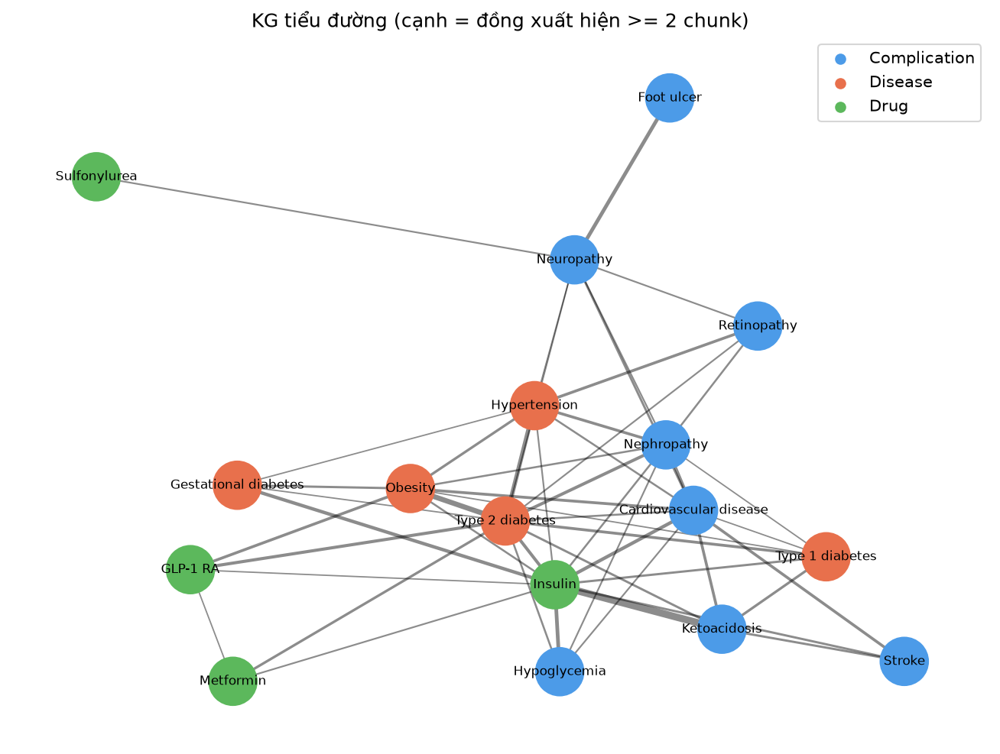{width=100%}

KG có 319 nút (21 thực thể và 298 bài báo) và 498 cạnh. Các bộ ba mạnh nhất cho thấy KG
học được những liên hệ quen thuộc trong y văn: insulin được nghiên cứu cùng bệnh tim mạch,
bệnh thận là biến chứng của đái tháo đường type 2, GLP-1 RA đi cùng type 2 và béo phì. Vì
quan hệ dựa trên đồng xuất hiện, cạnh chỉ nói hai thực thể được nhắc cùng nhau, không khẳng
định thuốc nào điều trị bệnh nào.

## 5.4. Hỏi đáp mẫu và đánh giá

```
Retriever: hybrid | hub: set()
=== RAG thường ===
Thực thể trong câu hỏi: ['Cardiovascular disease', 'Nephropathy'] | mở rộng KG: []
Trả lời: A thorough therapeutic approach, in both the early and later stages of diabetic
    nephropathy, is fundamental because of the increased risk of morbidity and
    mortality. Finally, the manipulation of the sex hormone balance, genetic screening
    for a predisposition to progressive renal dysfunction and, eventually, gene therapy
    complete the scenario for future approaches to this major complication of diabetic
    disease. A low glomerular filtration rate (<60 mL/min/1.73 m(2)) is also an
    independent risk factor for cardiovascular events and death.
Nguồn: ['PMID:14696750', 'PMID:21531886'] 

=== GraphRAG ===
Thực thể trong câu hỏi: ['Cardiovascular disease', 'Nephropathy'] | mở rộng KG:
    ['Insulin', 'Type 2 diabetes', 'Hypertension', 'Obesity']
  KG: (Cardiovascular disease) -[drug_studied_for, w=9.0]-> (Insulin)
  KG: (Cardiovascular disease) -[comorbid_with, w=8.0]-> (Nephropathy)
  KG: (Cardiovascular disease) -[comorbid_with, w=7.0]-> (Ketoacidosis)
  KG: (Cardiovascular disease) -[comorbid_with, w=7.0]-> (Stroke)
  KG: (Nephropathy) -[comorbid_with, w=8.0]-> (Cardiovascular disease)
  KG: (Nephropathy) -[complication_of, w=8.0]-> (Type 2 diabetes)
Trả lời: CKD predisposes to atherosclerosis, adds to the mortality and morbidity risk of
    cardiovascular disease (CVD), and increases risks for patients undergoing PCI. A
    thorough therapeutic approach, in both the early and later stages of diabetic
    nephropathy, is fundamental because of the increased risk of morbidity and
    mortality. A low glomerular filtration rate (<60 mL/min/1.73 m(2)) is also an
    independent risk factor for cardiovascular events and death.
Nguồn: ['PMID:14696750', 'PMID:17224890', 'PMID:21531886'] 

     RAG  GraphRAG
k                 
2  0.417     0.750
4  0.667     0.833
6  0.667     0.833
```

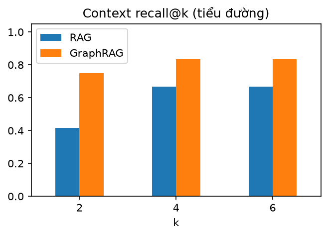{width=55%}

Với câu hỏi mẫu, RAG thường lấy được các bài về bệnh thận do đái tháo đường nhưng bỏ
qua khía cạnh tim mạch. GraphRAG nhận diện Nephropathy và Cardiovascular disease, mở rộng
sang các láng giềng mạnh trong KG và kéo thêm bài nói về nguy cơ xơ vữa, tim mạch ở bệnh
nhân bệnh thận mạn. Trên cả bộ câu hỏi, GraphRAG tăng context recall@2 từ 0,417 lên 0,750 và
recall@4 từ 0,667 lên 0,833. Đây là bài GraphRAG có lợi rõ nhất, vì câu hỏi y khoa thường nối nhiều
thực thể (thuốc với biến chứng) mà một đoạn văn đơn lẻ không chứa đủ.

# 6. Bài 2: KB và RAG cho chứng khoán (mục 4.5)

## 6.1. Dữ liệu và phân tích nhanh

Giá đóng cửa đã điều chỉnh của năm cổ phiếu lấy từ yfinance (hậu tố `.VN`), thông tin
công ty từ `Ticker.info`, tin tức từ Google News RSS với tên từng công ty làm từ khóa:

```python
def fetch_news(queries, path):
    rows = []
    for q in queries:
        r = requests.get(
            "https://news.google.com/rss/search",
            headers=H,
            timeout=30,
            params={"q": q, "hl": "en-US", "gl": "US", "ceid": "US:en"},
        )
        for it in ET.fromstring(r.content).findall(".//item"):
            src = it.find("source")
            rows.append(
                {
                    "query": q,
                    "title": (it.findtext("title") or "").rsplit(" - ", 1)[0],
                    "source": src.text if src is not None else "",
                    "date": it.findtext("pubDate"),
                    "link": it.findtext("link"),
                }
            )
    pd.DataFrame(rows).drop_duplicates("title").to_csv(path, index=False)
```

Kết quả RSS là XML; `findall(".//item")` lấy từng tin, tiêu đề có dạng "Nội dung - Tên
báo" nên `rsplit(" - ", 1)[0]` cắt bỏ tên báo, và `drop_duplicates` bỏ tin trùng giữa các
từ khóa. Hai hàm chuyển bảng giá thành số liệu theo năm:

```python
def yearly_stats(px, level_cols=()):
    rows = []
    for t in px.columns:
        s = px[t].dropna()
        for y, g in s.groupby(s.index.year):
            if len(g) < 30:
                continue
            r = {
                "asset": t,
                "year": y,
                "start": g.iloc[0],
                "last": g.iloc[-1],
                "high": g.max(),
                "low": g.min(),
            }
            if t not in level_cols:
                r.update(
                    {
                        "return": g.iloc[-1] / g.iloc[0] - 1,
                        "vol": g.pct_change().std() * np.sqrt(252),
                        "mdd": (g / g.cummax() - 1).min(),
                    }
                )
            rows.append(r)
    return pd.DataFrame(rows)


def weekly_changes(px, level_cols=()):
    w = px.resample("W").last()
    ch = w.pct_change(fill_method=None)
    for c in level_cols:
        ch[c] = w[c].diff()  # lợi suất / VIX: dùng chênh lệch mức, không dùng %
    return ch
```

Lợi suất năm = giá cuối năm / giá đầu năm - 1; độ biến động năm hóa = độ lệch chuẩn lợi
suất ngày × √252; sụt giảm tối đa dùng `g.cummax()` (đỉnh cao nhất tới từng ngày) và lấy giá
trị nhỏ nhất của `g / g.cummax() - 1`. Tương quan được tính trên lợi suất **tuần** để giảm
nhiễu và tránh lệch ngày nghỉ; với chỉ số dạng mức (lợi suất trái phiếu, VIX) dùng chênh lệch
mức thay cho phần trăm.

```
Bảng giá: (1771, 5) 2020-01-01 -> 2026-10-15 | tin tức: 579
asset FPT HPG VCB VIC VNM
year
2020 0.213 1.156 0.091 -0.059 0.153
2021 0.848 0.527 0.038 -0.011 -0.175
2022 0.015 -0.485 0.015 -0.434 -0.057
2023 0.473 0.553 0.185 -0.171 -0.075
2024 0.852 0.049 0.136 -0.091 -0.009
2025 -0.264 0.189 -0.370 7.365 0.051
2026 -0.325 -0.120 -0.009 0.285 -0.035
VNM FPT VCB HPG VIC
VNM 1.00 0.41 0.38 0.32 0.10
FPT 0.41 1.00 0.39 0.43 0.07
VCB 0.38 0.39 1.00 0.43 0.10
HPG 0.32 0.43 0.43 1.00 0.22
VIC 0.10 0.07 0.10 0.22 1.00
```

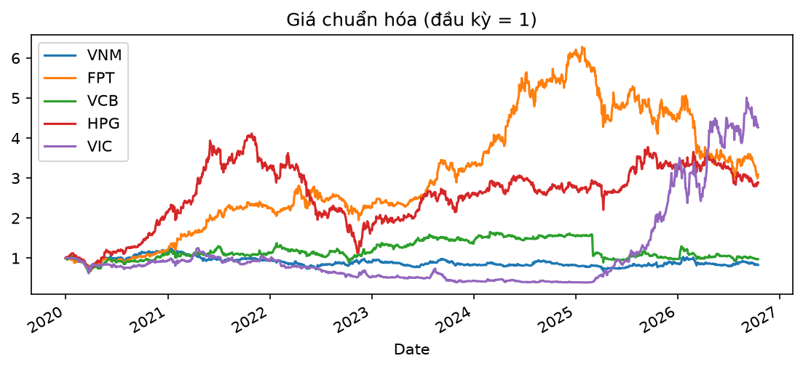{width=100%}

Bốn mã VNM, FPT, VCB, HPG tương quan với nhau ở mức 0,3-0,4; VIC gần như đi riêng. Năm
lợi suất cao nhất của từng mã: FPT +85% (2024); HPG +116% (2020); VCB +19% (2023); VIC +736% (2025); VNM +15% (2020). Mức tăng của VIC năm 2025 là số liệu của yfinance và
được giữ nguyên.

## 6.2. Knowledge Base: chuyển bảng thành văn bản

```python
def stats_to_text(r, label, level_cols=()):
    if r.asset in level_cols:
        return (
            f"{r.asset} ({label}) in {r.year}: started at {r.start:.2f}, "
            f"ended at {r['last']:.2f}, ranged from {r.low:.2f} to {r.high:.2f}."
        )
    return (
        f"{r.asset} ({label}) in {r.year}: price return {r['return']:+.1%}, "
        f"annualized volatility {r.vol:.1%}, maximum drawdown {r.mdd:.1%}, "
        f"last price {r['last']:.2f}."
    )


def corr_text(a, b, c):
    s = "strong" if abs(c) > 0.5 else "moderate" if abs(c) > 0.3 else "weak"
    sign = "positive" if c > 0 else "negative"
    return (
        f"Weekly return correlation between {a} and {b} is {c:+.2f} "
        f"({s} {sign} relationship)."
    )
```

Mỗi dòng thống kê thành một câu tiếng Anh, ví dụ "HPG (Hoa Phat Group..., sector Basic
Materials) in 2021: price return +52.7%, annualized volatility 34.7%...". `{r['return']:+.1%}`
định dạng số thành phần trăm có dấu. Câu chứa mã, tên công ty, ngành và năm, nên cả TF-IDF lẫn
từ điển thực thể đều bắt được. Từ điển của bài có công ty, ngành, chủ đề tin (lợi nhuận, cổ
tức, khối ngoại, VN-Index, xuất khẩu, AI và chip, xe điện) và các **năm** 2020-2026: năm là
thực thể để câu hỏi "năm 2021" được nối với đúng bản ghi thống kê.

```
636 tài liệu: Counter({'news': 579, 'stats': 35, 'profile': 12, 'corr': 10})
```

## 6.3. Knowledge Graph

```python
G_stock = new_kg(STOCK_LEX)
# (1) từ bảng: ngành và tương quan
for t, sec in SECTOR.items():
    G_stock.add_edge(
        t,
        sec,
        rel="BELONGS_TO_SECTOR",
        weight=5,
        industry=info[t].get("industry"),
        source="table",
    )
for a, b in itertools.combinations(sp.columns, 2):
    c = float(s_corr.loc[a, b])
    if abs(c) >= 0.15:
        G_stock.add_edge(
            a, b, rel="CORRELATED_WITH", weight=10 * abs(c), corr=c, source="table"
        )
# (2) từ văn bản: đồng xuất hiện trong tin tức
stock_rel = make_rel(
    {
        ("Company", "Topic"): "in_news_with",
        ("Company", "Company"): "mentioned_with",
        ("Company", "Sector"): "related_to_sector",
        ("Sector", "Topic"): "sector_topic",
    }
)
add_cooccurrence(G_stock, s_news_docs, stock_rel)
```

Cạnh `BELONGS_TO_SECTOR` lấy từ thông tin công ty, ngành chi tiết lưu làm thuộc tính.
Chỉ cặp có |corr| từ 0,15 trở lên mới thành cạnh `CORRELATED_WITH`; trọng số = 10 × |corr| để
cùng thang với cạnh đếm từ tin tức, dấu thật giữ trong thuộc tính `corr`. Cuối cùng
`add_cooccurrence` trên tin tức thêm cạnh công ty - chủ đề.

```
Nút: 17 | cạnh: 54
Chủ đề tin tức gắn với từng công ty:
VNM [('Earnings', 7, 'in_news_with'), ('Export', 2, 'in_news_with'), ('AI & chips', 1,
    'in_news_with')]
FPT [('AI & chips', 46, 'in_news_with'), ('Earnings', 4, 'in_news_with'), ('VN-Index',
    2, 'in_news_with')]
VCB [('Earnings', 4, 'in_news_with'), ('AI & chips', 2, 'in_news_with'), ('Dividend', 1,
    'in_news_with')]
HPG [('Earnings', 7, 'in_news_with'), ('Export', 2, 'in_news_with'), ('Dividend', 1,
    'in_news_with')]
VIC [('Electric vehicles', 9, 'in_news_with'), ('VN-Index', 3, 'in_news_with'),
    ('Earnings', 1, 'in_news_with')]
Năm lợi suất cao nhất:
asset year return
FPT 2024 0.852196
HPG 2020 1.156011
VCB 2023 0.185429
VIC 2025 7.364982
VNM 2020 0.153360
```

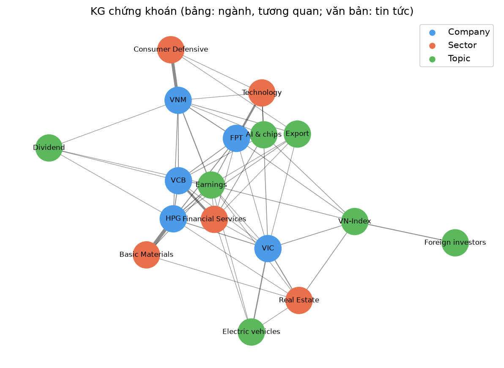{width=100%}

## 6.4. Hỏi đáp mẫu và đánh giá

```
=== RAG thường ===
Thực thể trong câu hỏi: ['2021', 'Basic Materials', 'HPG'] | mở rộng KG: []
Trả lời: Tue, 13 Jan 2026: Hoa Phat sets record with steel sales topping 10 million
    tonnes in 2025, up 31% year on year (source: HoaPhat). Mon, 12 Oct 2026: Hoa Phat
    sold over 10.3 million tons of steel in the first nine months, a 39% increase
    compared to the same period last year. Fri, 14 Aug 2026: Hoa Phat starts 700,000-tpy
    steel mill in Long An to strengthen southern market presence (source:
    megaproject.com).
Nguồn: ['news:307', 'news:327', 'news:341'] 

=== GraphRAG ===
Thực thể trong câu hỏi: ['2021', 'Basic Materials', 'HPG'] | mở rộng KG: ['Earnings',
    'FPT', 'VCB', 'VIC']
  KG: (Basic Materials) -[BELONGS_TO_SECTOR, w=40.0]-> (HPG)
  KG: (Basic Materials) -[sector_topic, w=3.0]-> (Earnings)
  KG: (Basic Materials) -[related, w=1.0]-> (Real Estate)
  KG: (HPG) -[BELONGS_TO_SECTOR, w=40.0]-> (Basic Materials)
  KG: (HPG) -[in_news_with, w=7.0]-> (Earnings)
  KG: (HPG) -[CORRELATED_WITH, w=5.3, corr=+0.43]-> (FPT)
Trả lời: HPG (Hoa Phat Group Joint Stock Company, sector Basic Materials) in 2021: price
    return +52.7%, annualized volatility 34.7%, maximum drawdown -22.5%, last price
    23633.99. Tue, 13 Jan 2026: Hoa Phat sets record with steel sales topping 10 million
    tonnes in 2025, up 31% year on year (source: HoaPhat). Mon, 12 Oct 2026: Hoa Phat
    sold over 10.3 million tons of steel in the first nine months, a 39% increase
    compared to the same period last year.
Nguồn: ['news:307', 'news:341', 'stats:HPG:2021'] 

   RAG  GraphRAG
k               
2  0.7       0.7
4  0.7       0.9
6  0.7       0.9
```

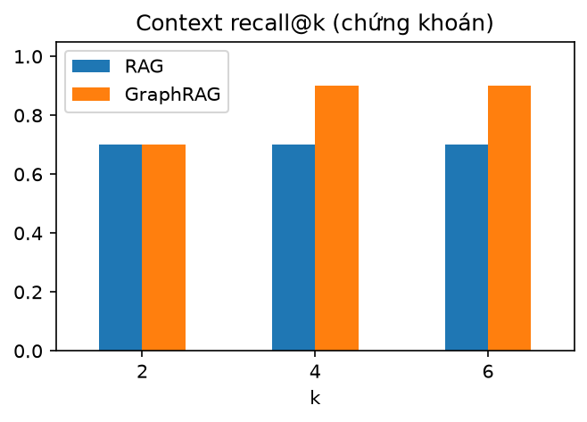{width=55%}

Với câu hỏi về Hòa Phát năm 2021, cả hai chế độ đều tìm được bản ghi thống kê và tin
tức, nhưng GraphRAG trả kèm facts về ngành và tương quan của HPG. Trên cả bộ câu hỏi,
GraphRAG nâng recall@4 từ 0,700 lên 0,900: những câu hỏi ghép nhiều thực thể (công ty + chủ đề tin,
hai công ty + một năm) được lợi từ điểm cộng theo thực thể.

# 7. Bài 3: KB và RAG cho vàng (mục 4.5)

## 7.1. Dữ liệu và phân tích nhanh

```
Bảng: (2480, 8) 2020-01-01 -> 2026-10-15 | tin tức: 632
year start last return vol mdd
0 2020 1524.5 1895.1 0.243 0.217 -0.142
1 2021 1946.6 1828.6 -0.061 0.148 -0.141
2 2022 1800.1 1826.2 0.014 0.157 -0.202
3 2023 1846.1 2071.8 0.122 0.134 -0.109
4 2024 2073.4 2641.0 0.274 0.153 -0.082
5 2025 2669.0 4341.1 0.626 0.209 -0.092
6 2026 4329.6 4175.9 -0.035 0.296 -0.249
corr với GOLD
USD -0.43
US10Y -0.25
VIX -0.16
OIL 0.07
BTC 0.13
SP500 0.26
SILVER 0.79
```

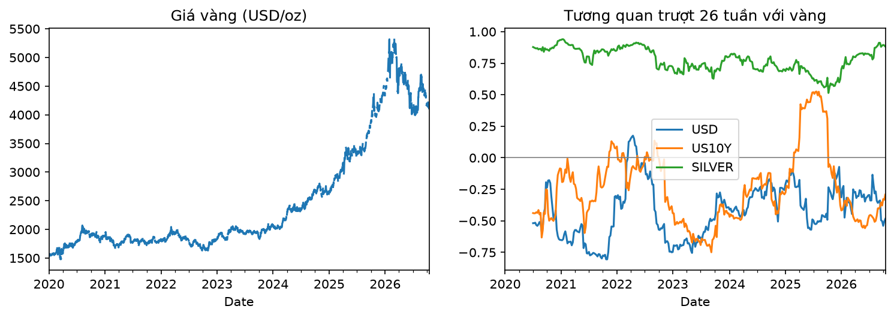{width=100%}

Vàng tăng mạnh nhất năm 2025 (+62,6%), sau +27,4% năm 2024. Tương quan tuần với vàng: bạc 0,79,
USD index -0,43, lợi suất trái phiếu Mỹ 10 năm -0,25. Đồ thị tương quan trượt cho thấy quan hệ
âm với USD và lợi suất không cố định mà dao động theo giai đoạn, nên một cạnh tương quan
trong KG là con số trung bình cả giai đoạn, không phải quy luật bất biến.

## 7.2. Knowledge Base

KB gồm 716 tài liệu: 632 tin tức từ bảy truy vấn (giá vàng, Fed và lãi suất, ngân hàng
trung ương mua vàng, lạm phát và USD, trú ẩn và địa chính trị, dòng tiền ETF, nhu cầu Trung
Quốc và Ấn Độ), cộng các bản ghi thống kê năm và tương quan sinh từ bảng bằng đúng hai hàm
`stats_to_text`, `corr_text` của chương 6. Từ điển có bốn nhóm: tài sản (GOLD, SILVER, USD,
US10Y, OIL, SP500, VIX, BTC), yếu tố (Fed, lạm phát, ngân hàng trung ương, địa chính trị,
suy thoái, dòng tiền ETF), khu vực (Trung Quốc, Ấn Độ) và chủ đề (kỷ lục, trú ẩn an toàn).

```
716 tài liệu: Counter({'news': 632, 'stats': 56, 'corr': 28})
Thực thể phổ biến trong tin: [('GOLD', 609), ('Inflation', 117), ('USD', 99), ('Fed',
    99), ('China', 91), ('Central banks', 89), ('ETF flows', 86), ('Geopolitics', 75)]
```

## 7.3. Knowledge Graph: ba nguồn quan hệ

```python
G_gold = new_kg(GOLD_LEX)
# (1) từ văn bản: đồng xuất hiện trong tin
gold_rel = make_rel(
    {
        ("Asset", "Driver"): "influenced_by",
        ("Asset", "Asset"): "co_moves_with",
        ("Asset", "Region"): "demand_from",
        ("Asset", "Theme"): "described_as",
        ("Driver", "Driver"): "linked_with",
        ("Driver", "Theme"): "drives",
    }
)
add_cooccurrence(G_gold, g_news_docs, gold_rel)
# (2) từ bảng: tương quan (cạnh tin tức đã có thì chỉ gắn thêm thuộc tính corr)
for a, b in itertools.combinations(gm.columns, 2):
    c = float(g_corr.loc[a, b])
    if abs(c) < 0.15:
        continue
    if G_gold.has_edge(a, b):
        G_gold[a][b]["corr"] = c
    else:
        G_gold.add_edge(
            a, b, rel="CORRELATED_WITH", weight=10 * abs(c), corr=c, source="table"
        )
# (3) tri thức chuyên gia
DOMAIN = [
    ("Fed", "US10Y", "sets_policy_rate_for"),
    ("US10Y", "GOLD", "opportunity_cost_of"),
    ("USD", "GOLD", "prices"),
    ("Inflation", "GOLD", "hedged_by"),
    ("Geopolitics", "Safe haven", "raises_demand_for"),
    ("Safe haven", "GOLD", "role_of"),
    ("Central banks", "GOLD", "accumulate"),
    ("ETF flows", "GOLD", "investment_demand_for"),
    ("Fed", "USD", "affects"),
]
for a, b, r in DOMAIN:
    if G_gold.has_edge(a, b):
        G_gold[a][b].update(rel=r, domain=True)
    else:
        G_gold.add_edge(a, b, rel=r, weight=3, source="domain")
```

Từ tin tức: mỗi tiêu đề có nhiều thực thể thì nối chúng với nhau. Từ bảng: tương quan
tuần giữa 8 tài sản; nếu tin tức đã tạo cạnh giữa hai tài sản thì chỉ gắn thêm thuộc tính
`corr`, không ghi đè trọng số đếm từ tin. Từ tri thức chuyên gia: danh sách `DOMAIN` gồm 9
quan hệ nhân quả đã biết, ví dụ lợi suất trái phiếu là chi phí cơ hội của việc giữ vàng (vàng
không trả lãi); cạnh đã có thì đổi nhãn quan hệ cho rõ nghĩa, chưa có thì thêm với
`source="domain"` (nét đứt trên hình). Kết quả: 18 nút, 99 cạnh, trong đó 87 cạnh từ tin
tức, 12 cạnh từ bảng và 0 cạnh chuyên gia mới.

```
Nút: 18 | cạnh: 99 | nguồn cạnh: Counter({'text': 87, 'table': 12})
Yếu tố gắn với vàng mạnh nhất: [('Inflation', 117, 'hedged_by'), ('Fed', 99,
    'influenced_by'), ('Central banks', 87, 'accumulate'), ('ETF flows', 80,
    'investment_demand_for'), ('Geopolitics', 73, 'influenced_by')]
```

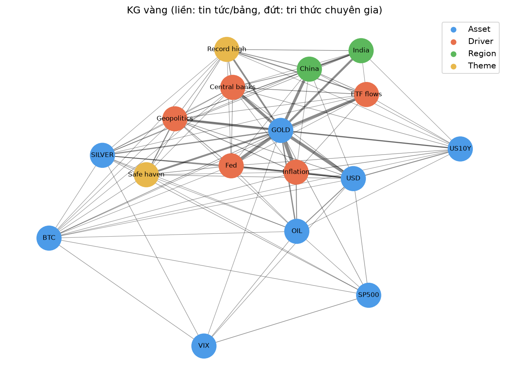{width=100%}

## 7.4. Hỏi đáp mẫu và đánh giá

```
Hub: {'GOLD'}
=== RAG thường ===
Thực thể trong câu hỏi: ['Fed', 'GOLD', 'USD'] | mở rộng KG: []
Trả lời: Wed, 07 Oct 2026: Gold Prices Fall as Dollar Strengthens Ahead of Federal
    Reserve Minutes (source: Yahoo Finance). Thu, 08 Oct 2026: Gold Prices Stabilise
    After Two-Month Low as Investors Assess Federal Reserve Rate Outlook (source: Yahoo
    Finance). Wed, 14 Oct 2026: Gold and silver prices decline as hotter-than-expected
    CPI data reignites pressure on the Federal Reserve to raise interest rates (source:
    Moomoo).
Nguồn: ['news:106', 'news:111', 'news:143'] 

=== GraphRAG ===
Thực thể trong câu hỏi: ['Fed', 'GOLD', 'USD'] | mở rộng KG: ['Inflation', 'Central
    banks', 'Geopolitics', 'China']
  KG: (Fed) -[influenced_by, w=99.0]-> (GOLD)
  KG: (Fed) -[linked_with, w=25.0]-> (Inflation)
  KG: (Fed) -[affects, w=14.0]-> (USD)
  KG: (Fed) -[linked_with, w=8.0]-> (Geopolitics)
  KG: (GOLD) -[hedged_by, w=117.0]-> (Inflation)
  KG: (GOLD) -[influenced_by, w=99.0]-> (Fed)
Trả lời: Wed, 07 Oct 2026: Gold Prices Fall as Dollar Strengthens Ahead of Federal
    Reserve Minutes (source: Yahoo Finance). Mon, 21 Sep 2026: Gold Falls as Stronger
    Dollar and Fed Rate Hike Expectations Weigh on Prices (source: Yahoo Finance). Tue,
    22 Sep 2026: Gold Prices Fall as Stronger Dollar and Fed Rate Expectations Weigh on
    Bullion (source: Yahoo Finance).
Nguồn: ['news:111', 'news:142', 'news:178'] 

   RAG  GraphRAG
k               
2  0.9       0.9
4  0.9       0.9
6  1.0       0.9
```

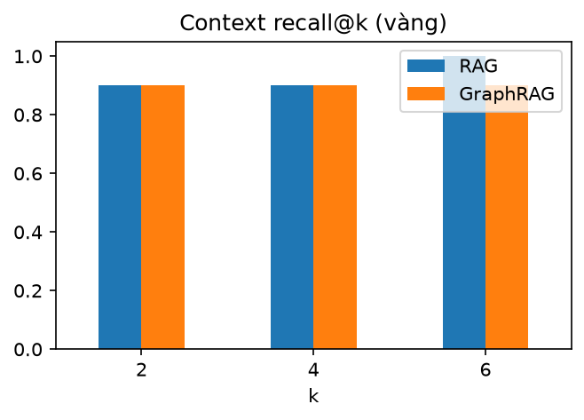{width=55%}

GOLD bị loại khỏi phần mở rộng vì là hub (có mặt trong hầu hết tài liệu), nên GraphRAG
mở rộng sang các yếu tố như lạm phát, ngân hàng trung ương, địa chính trị. Ở bài này hai chế
độ ngang nhau (recall@4 cùng là 0,900): hầu hết tài liệu đều có chữ "gold", câu hỏi thường chứa
từ khóa đặc trưng (Fed, ETF, bitcoin) nên truy xuất vector đã đủ tốt. Ở k = 6, RAG thường còn
nhỉnh hơn (1,000 so với 0,900), có thể do điểm cộng từ KG đẩy một tài liệu thiếu từ khóa vàng lên
top-k; với 10 câu hỏi, chênh lệch này chỉ là một câu.

# 8. Deploy và demo (mục 4.6)

## 8.1. Đóng gói

```python
DEPLOY = os.path.join(WORK_DIR, "deploy")
os.makedirs(DEPLOY, exist_ok=True)
for name, docs, lex, G in [
    ("diabetes.json", diab_docs, DIAB_LEX, G_diab),
    ("stocks.json", stock_docs, STOCK_LEX, G_stock),
    ("gold.json", gold_docs, GOLD_LEX, G_gold),
]:
    json.dump(
        {"docs": docs, "lexicon": lex, "graph": graph_to_dict(G)},
        open(os.path.join(DEPLOY, name), "w", encoding="utf-8"),
        ensure_ascii=False,
    )
shutil.copy(
    os.path.join(WORK_DIR, "ragkg_core.py"), os.path.join(DEPLOY, "ragkg_core.py")
)
```

KB, từ điển và KG của mỗi bài được ghi thành một file JSON, kèm bản sao `ragkg_core.py`.
Thư mục `deploy/` vì thế tự chạy được ở bất kỳ đâu có Python (máy cá nhân, server, Hugging
Face Spaces) mà không cần notebook hay dữ liệu gốc.

## 8.2. Giao diện Gradio

```python
FILES = [("Tiểu đường", "diabetes.json"), ("Chứng khoán", "stocks.json"),
         ("Vàng", "gold.json")]
SYSTEMS = {}
for name, f in FILES:
    d = json.load(open(os.path.join(HERE, f), encoding="utf-8"))
    retr = Retriever([x["text"] for x in d["docs"]], use_embeddings=False)
    G = graph_from_dict(d["graph"])
    SYSTEMS[name] = GraphRAG(d["docs"], d["lexicon"], G, retr)


def ask(domain, question, mode, k):
    m = "graph" if mode == "GraphRAG" else "rag"
    r = SYSTEMS[domain].answer(question, k=int(k), mode=m)
    facts = "\n".join(r["kg_facts"]) or "(RAG thường: không dùng KG)"
    expand = (", ".join(r["query_entities"]) + " -> "
              + ", ".join(r["graph_expansion"]))
    return r["answer"], ", ".join(r["sources"]), expand, facts


SLUG = {"diabetes": "Tiểu đường", "stocks": "Chứng khoán", "gold": "Vàng"}


def from_url(request: gr.Request):
    # ?domain=gold&q=...&mode=rag: mở sẵn câu hỏi và trả lời ngay khi tải trang
    p = dict(request.query_params) if request else {}
    d = SLUG.get(p.get("domain"), "Tiểu đường")
    q = p.get("q") or EXAMPLES[d]
    m = "RAG" if p.get("mode") == "rag" else "GraphRAG"
    return (d, q, m, *ask(d, q, m, 4))
```

Mỗi bài được nạp thành một đối tượng `GraphRAG`; `use_embeddings=False` cho app chỉ dùng
TF-IDF để khởi động trong vài giây, không cần tải mô hình. `ask` nhận bài, câu hỏi, chế độ,
top-k từ giao diện và trả về bốn chuỗi: câu trả lời, nguồn, thực thể cùng phần mở rộng KG,
facts từ KG. `from_url` đọc tham số trên đường dẫn (`?domain=gold&q=...&mode=rag`) để mở sẵn
câu hỏi và trả lời ngay khi tải trang; các ảnh demo dưới đây được chụp tự động nhờ cơ chế
này. Phần khai báo giao diện:

```python
with gr.Blocks(title="KG + RAG") as demo:
    gr.Markdown("# Knowledge Graph + RAG: tiểu đường, chứng khoán, vàng\n"
                "Hỏi bằng tiếng Anh (kho dữ liệu là tiếng Anh).")
    domain = gr.Dropdown(list(SYSTEMS), value="Tiểu đường", label="Bài")
    question = gr.Textbox(label="Câu hỏi", value=EXAMPLES["Tiểu đường"])
    domain.input(lambda d: EXAMPLES[d], domain, question)
    with gr.Row():
        mode = gr.Radio(["GraphRAG", "RAG"], value="GraphRAG", label="Chế độ")
        k = gr.Slider(1, 8, value=4, step=1, label="top-k")
    btn = gr.Button("Hỏi")
    ans = gr.Textbox(label="Câu trả lời", lines=6)
    src = gr.Textbox(label="Nguồn")
    ent = gr.Textbox(label="Thực thể -> mở rộng KG")
    facts = gr.Textbox(label="Facts từ KG", lines=5)
    btn.click(ask, [domain, question, mode, k], [ans, src, ent, facts])
    demo.load(from_url, None, [domain, question, mode, ans, src, ent, facts])
```

`btn.click(ask, inputs, outputs)` nối nút Hỏi với hàm `ask`: Gradio đọc giá trị bốn ô đầu
vào, gọi hàm, rồi điền bốn giá trị trả về vào bốn ô kết quả theo đúng thứ tự. Trên Kaggle, ô
cuối notebook gọi `demo.launch(share=True)` để có đường dẫn công khai tạm thời; ngoài Kaggle
chạy `python deploy/app.py` rồi mở http://localhost:7860.

```
[Tiểu đường] Which drugs are studied for diabetic kidney disease?
  -> MicroRNAs: new biomarkers and promising therapeutic targets for diabetic kidney
    disease.. Diabetic kidney disease (DKD) is a chronic complication of diabetes
    mellitus associated wi
  nguồn: PMID:30742700, PMID:37737333
[Chứng khoán] How did Hoa Phat perform in 2021?
  -> HPG (Hoa Phat Group Joint Stock Company, sector Basic Materials) in 2021: price
    return +52.7%, annualized volatility 34.7%, maximum drawdown -22.5%, last price
    23633.99. Thu, 17 Ju
  nguồn: news:358, news:370, stats:HPG:2021
[Vàng] How do Fed rate cuts affect gold prices?
  -> Wed, 14 Oct 2026: Rising Government Debt Extends Gold’s Appeal Beyond Fed Rate Cuts
    (source: Crux Investor). Tue, 22 Sep 2026: Gold Prices Fall as Stronger Dollar and
    Fed Rate Expe
  nguồn: news:142, news:178, news:54
```

## 8.3. Demo

Ba ảnh dưới chụp từ bản đóng gói chạy trên máy cá nhân, chế độ GraphRAG, top-k = 4. Bản
này dùng TF-IDF nên câu trả lời có thể khác chút ít so với notebook (hybrid).

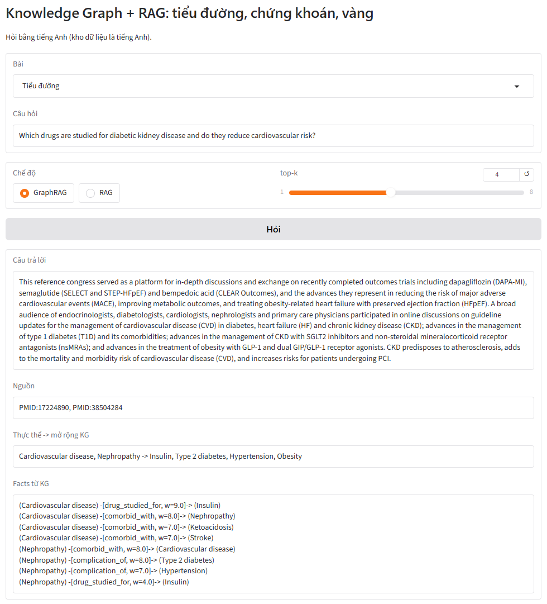{width=92%}

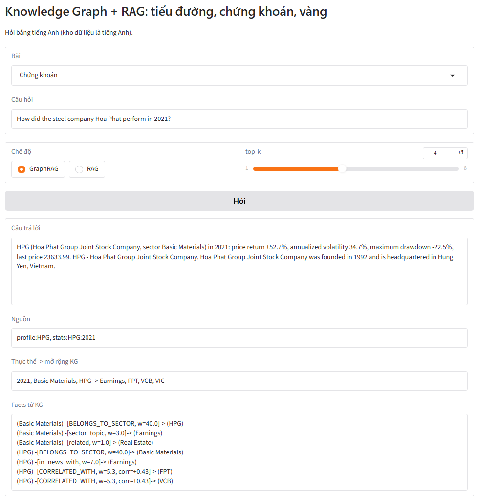{width=92%}

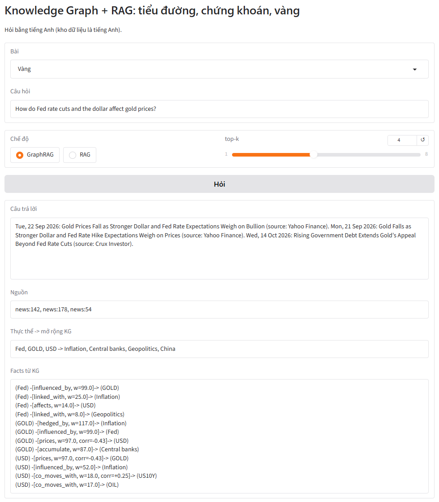{width=92%}

# 9. So sánh và đánh giá

## 9.1. Tổng hợp kết quả

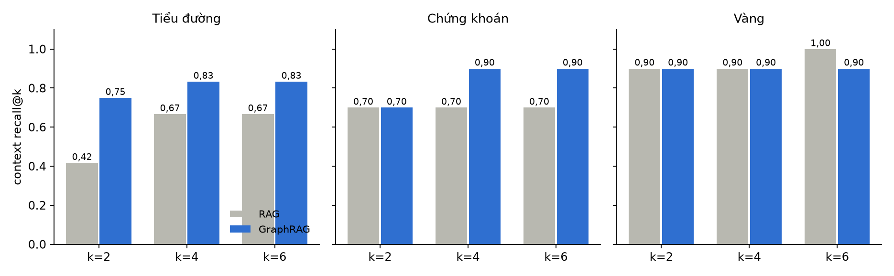{width=100%}

| Bài | k | RAG | GraphRAG | Chênh lệch |
|---|---|---|---|---|
| Tiểu đường | 2 | 0,417 | 0,750 | +0,333 |
| Tiểu đường | 4 | 0,667 | 0,833 | +0,166 |
| Tiểu đường | 6 | 0,667 | 0,833 | +0,166 |
| Chứng khoán | 2 | 0,700 | 0,700 | +0,000 |
| Chứng khoán | 4 | 0,700 | 0,900 | +0,200 |
| Chứng khoán | 6 | 0,700 | 0,900 | +0,200 |
| Vàng | 2 | 0,900 | 0,900 | +0,000 |
| Vàng | 4 | 0,900 | 0,900 | +0,000 |
| Vàng | 6 | 1,000 | 0,900 | -0,100 |

## 9.2. Khi nào KG giúp ích

Kết quả theo một quy luật rõ: GraphRAG có lợi nhất khi **câu hỏi nối nhiều thực thể và
tài liệu liên quan nằm rải rác**, như câu hỏi thuốc - biến chứng ở bài tiểu đường hay công ty -
chủ đề tin ở bài chứng khoán. Khi câu hỏi đã chứa từ khóa rất đặc trưng và gần như mọi tài
liệu đều nói về cùng một chủ thể (bài vàng), truy xuất hybrid đã tìm đủ ngữ cảnh và KG không
thêm được gì. Ngoài điểm số, KG mang lại thứ mà RAG thường không có: các facts có trọng số đi
kèm câu trả lời (thực thể nào liên quan, qua quan hệ gì, mạnh tới đâu), giúp người dùng kiểm
tra và hiểu vì sao hệ thống chọn các tài liệu đó.

## 9.3. Giới hạn của bài

* Bộ câu hỏi nhỏ (10-12 câu mỗi bài) do tự soạn: một câu đúng hay sai làm recall đổi 0,08-0,1,
  nên kết quả mang tính minh họa, chưa phải kiểm định thống kê.
* Nhận diện thực thể bằng từ điển chính xác nhưng độ phủ thấp (0,82 thực thể mỗi đoạn ở bài
  tiểu đường).
* Quan hệ đồng xuất hiện chỉ nói hai thực thể được nhắc cùng nhau, không khẳng định quan hệ
  nhân quả; chỉ bài vàng có quan hệ nhân quả, và đó là tri thức đưa vào bằng tay.
* Tin tức chỉ có tiêu đề; truy vấn PubMed còn lẫn vài bài lạc đề.
* Dữ liệu và câu hỏi bằng tiếng Anh. Kết quả chứng khoán và vàng chỉ minh họa kỹ thuật,
  không phải khuyến nghị đầu tư.

# 10. Kết luận

Bài làm đi qua đủ sáu mục của đề và để lại những kết luận đo được:

1. **KG và KB.** Một KB thống nhất (văn bản, nguồn, thực thể) dựng được cho cả dữ liệu văn
   bản lẫn dữ liệu bảng; bảng phải được chuyển thành câu văn mới đưa vào RAG được, đồng thời
   cung cấp quan hệ định lượng (tương quan) mà văn bản không có.
2. **RAG và GraphRAG.** Truy xuất hybrid (embedding + TF-IDF) là nền tốt; GraphRAG chỉ thêm
   một bước cộng điểm theo thực thể và láng giềng trong KG nhưng tăng context recall@4 từ 0,667
   lên 0,833 ở bài tiểu đường và từ 0,700 lên 0,900 ở bài chứng khoán, ngang RAG ở bài vàng.
3. **Deploy.** Hệ thống đóng gói thành một thư mục JSON + Python chạy được không cần GPU hay
   API key, có giao diện Gradio và đường dẫn chia sẻ câu hỏi.

Hướng phát triển: dùng LLM hoặc scispaCy để trích thực thể và quan hệ có nhãn (treats,
causes, increases_risk), lưu KG vào Neo4j để truy vấn nhiều bước bằng Cypher, thêm dữ liệu
tiếng Việt với embedding đa ngữ, và đánh giá trên bộ câu hỏi lớn hơn có đo cả chất lượng câu
trả lời do LLM sinh ra.

# 11. Cách chạy lại toàn bộ bài

**Trên Kaggle:** Create, New Notebook, File, Import Notebook, chọn `RAG_KG_Kaggle.ipynb`;
bật Settings, Internet, On; Run All. Notebook tự cài thư viện và tải dữ liệu mới; muốn dùng
đúng bản chụp trong `data/` thì upload thư mục này thành Kaggle Dataset và gắn vào notebook.

**Trên máy cá nhân** (chạy lại notebook với dữ liệu đã chụp, rồi sinh lại báo cáo):

```
set LOCAL_DATA=data
set WORK_DIR=.
jupyter nbconvert --to notebook --execute --inplace RAG_KG_Kaggle.ipynb
python tools/build_report.py
python deploy/app.py
```

Lệnh `build_report.py` cần pandoc để xuất `.docx` và Microsoft Word để cập nhật mục lục,
xuất `.pdf`.

# Tài liệu tham khảo

1. Lý Hải Quân (2026). *KG_RAG: Knowledge Graph và RAG cho bệnh tiểu đường, chứng khoán,
   vàng* (mã nguồn, notebook, dữ liệu, demo). https://github.com/lyhaiquan/KG_RAG
2. Lewis P. và cộng sự (2020). *Retrieval-Augmented Generation for Knowledge-Intensive NLP
   Tasks*. NeurIPS 2020. https://arxiv.org/abs/2005.11401
3. Edge D. và cộng sự (2024). *From Local to Global: A Graph RAG Approach to Query-Focused
   Summarization*. Microsoft Research. https://arxiv.org/abs/2404.16130
4. Hogan A. và cộng sự (2021). *Knowledge Graphs*. ACM Computing Surveys 54(4).
   https://arxiv.org/abs/2003.02320
5. Singhal A. (2012). *Introducing the Knowledge Graph: things, not strings*. Google Blog.
6. NCBI E-utilities (PubMed), yfinance, Google News RSS, sentence-transformers
   (all-MiniLM-L6-v2), NetworkX, scikit-learn, Gradio.
