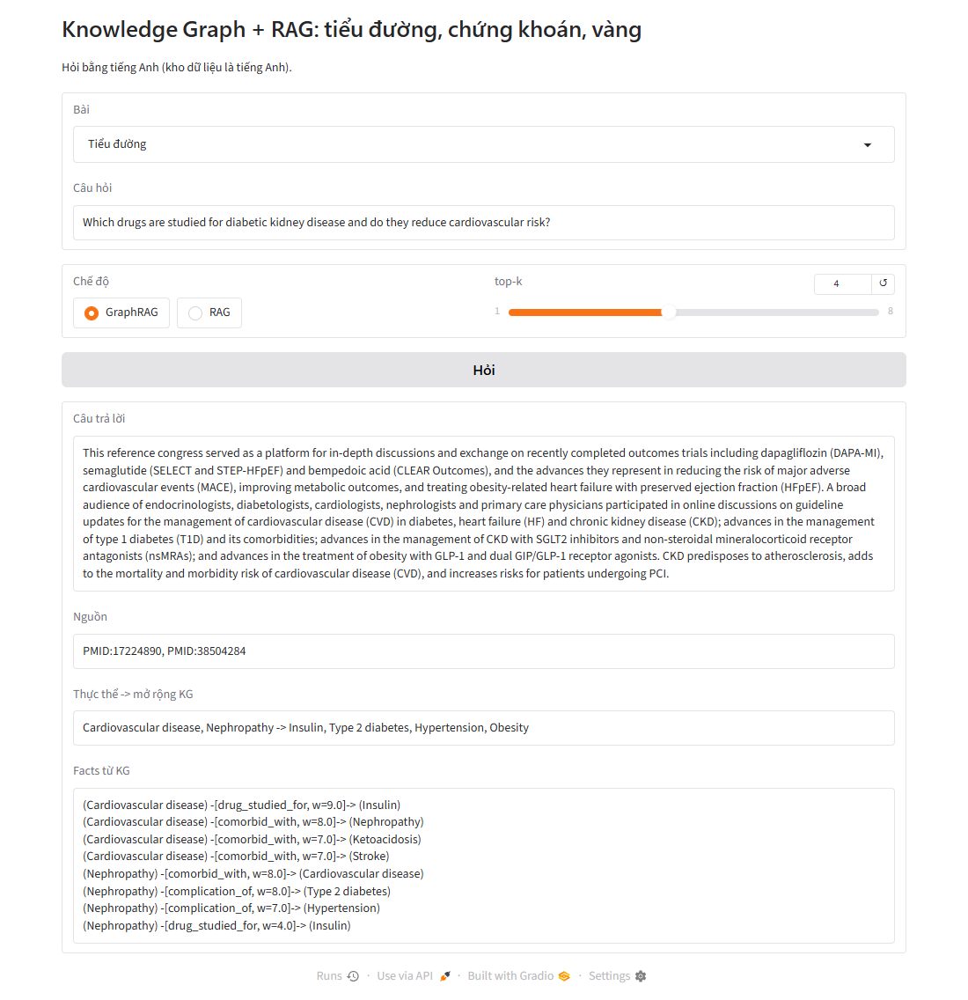
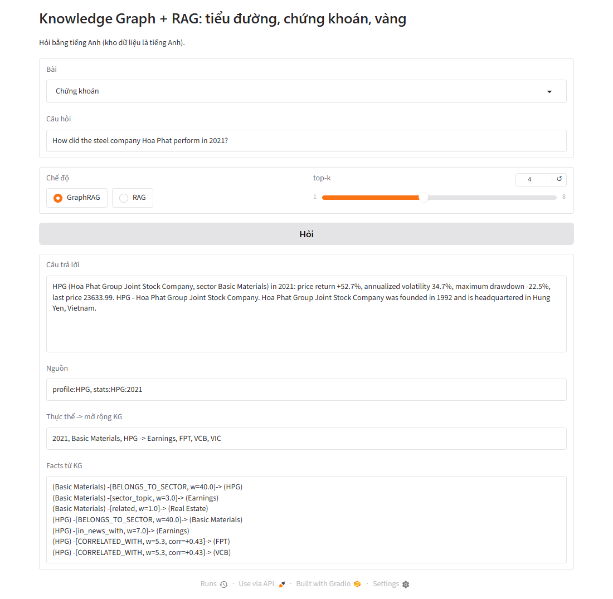
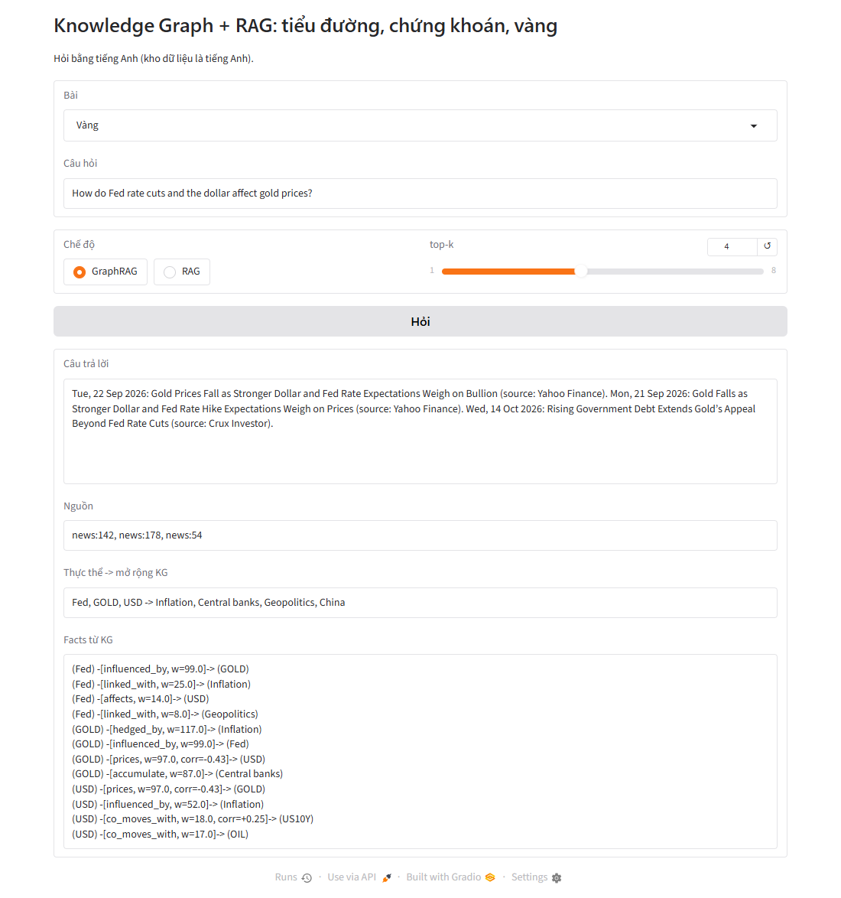

# KG_RAG: Knowledge Graph và RAG cho 3 bài toán

Chương 4: Knowledge Graph và RAG. Mỗi bài có Knowledge Graph (KG), RAG thường và GraphRAG (RAG + KG), kèm đánh giá và giao diện deploy.

| Bài | Dữ liệu văn bản | Dữ liệu bảng | Nguồn |
|---|---|---|---|
| Bệnh tiểu đường | 298 abstract y khoa | Nhãn MeSH | PubMed (NCBI E-utilities) |
| Chứng khoán | 579 tiêu đề tin + mô tả công ty | Giá VNM, FPT, VCB, HPG, VIC từ 2020; ngành | yfinance, Google News RSS |
| Vàng | 632 tiêu đề tin | Giá vàng, USD index, lợi suất TP Mỹ 10 năm, bạc, dầu, S&P 500, VIX, Bitcoin | yfinance, Google News RSS |

## Cấu trúc

```
RAG_KG_Kaggle.ipynb    notebook chính (mục 4.1–4.6), tự tải dữ liệu nếu thiếu
data/                  snapshot dữ liệu ngày 15/10/2026
deploy/
  ragkg_core.py        phần lõi: chunking, NER từ điển, dựng KG, retriever hybrid, GraphRAG, đánh giá
  app.py               giao diện Gradio cho cả 3 bài
  *.json               KB + KG + từ điển của từng bài
  requirements.txt
results/summary.json   số liệu chính do notebook ghi ra
figs/                  hình do notebook vẽ
tools/build_report.py  sinh báo cáo (.md -> .docx -> .pdf, cần pandoc + Word)
A05_07_quanlh.676.docx / .pdf   báo cáo
```

## Chạy trên Kaggle

1. Kaggle → Create → New Notebook → File → Import Notebook → chọn `RAG_KG_Kaggle.ipynb`.
2. Settings → Internet → On.
3. Run All. Notebook tự tải dữ liệu mới. Muốn dùng đúng snapshot trong `data/`, upload thư mục này thành Kaggle Dataset và gắn vào notebook; notebook sẽ tự tìm file trong `/kaggle/input`.

## Chạy giao diện deploy

```bash
cd deploy
pip install -r requirements.txt
python app.py
```

Link dạng `http://localhost:7860/?domain=gold&q=How%20do%20Fed%20rate%20cuts%20affect%20gold%3F` mở sẵn câu hỏi và trả lời ngay (`domain` = `diabetes` | `stocks` | `gold`, thêm `&mode=rag` để so với RAG thường).

## Demo

| Tiểu đường | Chứng khoán | Vàng |
|---|---|---|
|  |  |  |

## Phương pháp

- **KG:** thực thể nhận diện bằng từ điển + regex. Quan hệ lấy từ 3 nguồn: đồng xuất hiện trong văn bản, tương quan lợi suất tính từ bảng, và tri thức chuyên gia (bài vàng).
- **Truy xuất:** cosine embedding (`all-MiniLM-L6-v2`) + 0.5 × cosine TF-IDF.
- **GraphRAG:** cộng điểm α = 0.10 cho mỗi thực thể của câu hỏi có trong tài liệu, β = 0.04 cho mỗi láng giềng KG (bỏ các nút hub).
- **Đánh giá:** context recall@k trên 10–12 câu hỏi mỗi bài.

## Kết quả (context recall@4, lần chạy ngày 15/10/2026)

| Bài | RAG | GraphRAG |
|---|---|---|
| Tiểu đường | 0.667 | 0.833 |
| Chứng khoán | 0.7 | 0.9 |
| Vàng | 0.9 | 0.9 |

Bộ câu hỏi nhỏ nên các số này chỉ mang tính minh họa. Kết quả chứng khoán và vàng không phải khuyến nghị đầu tư.
